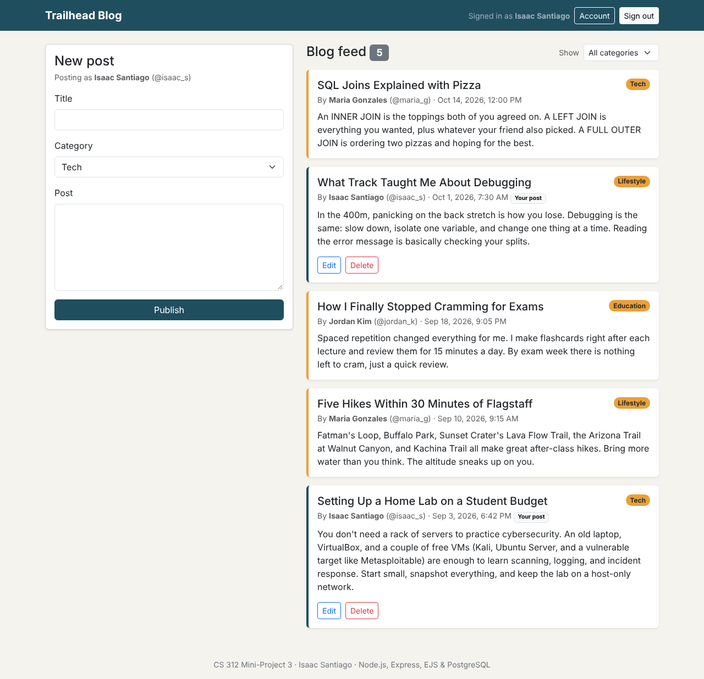
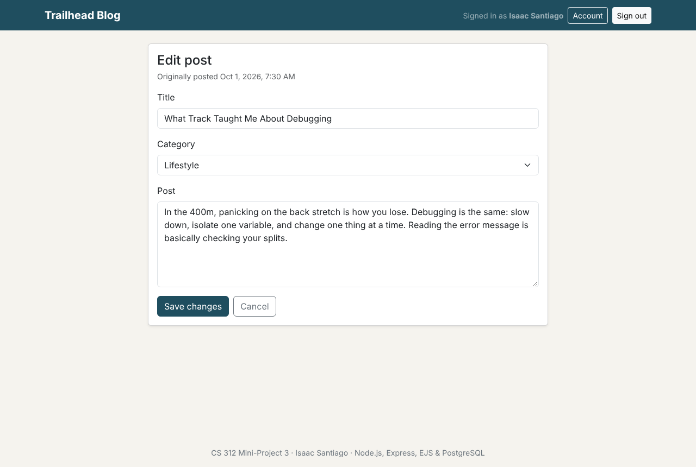
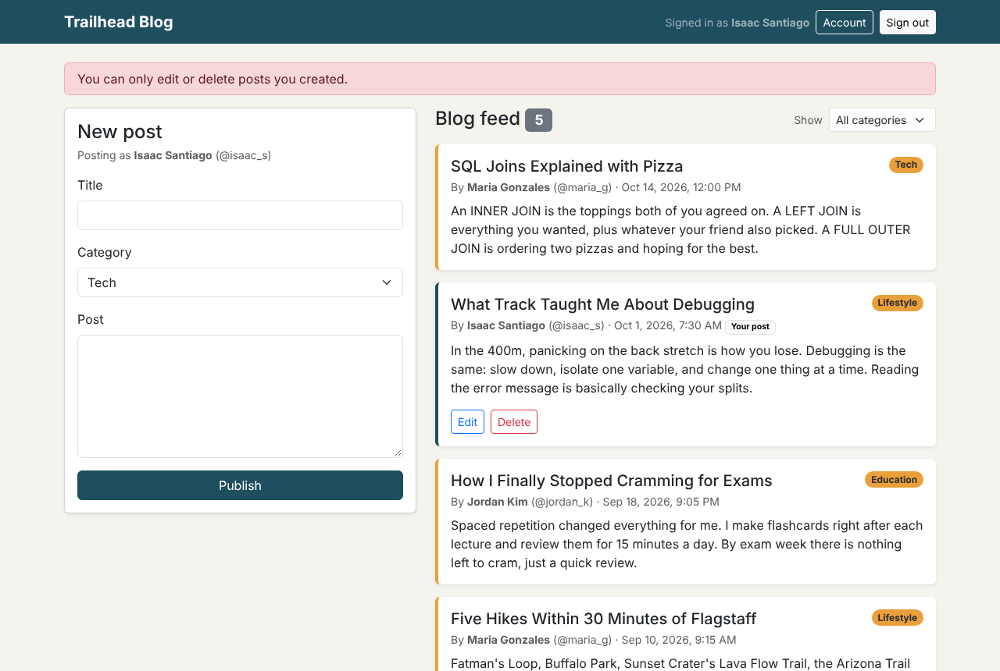
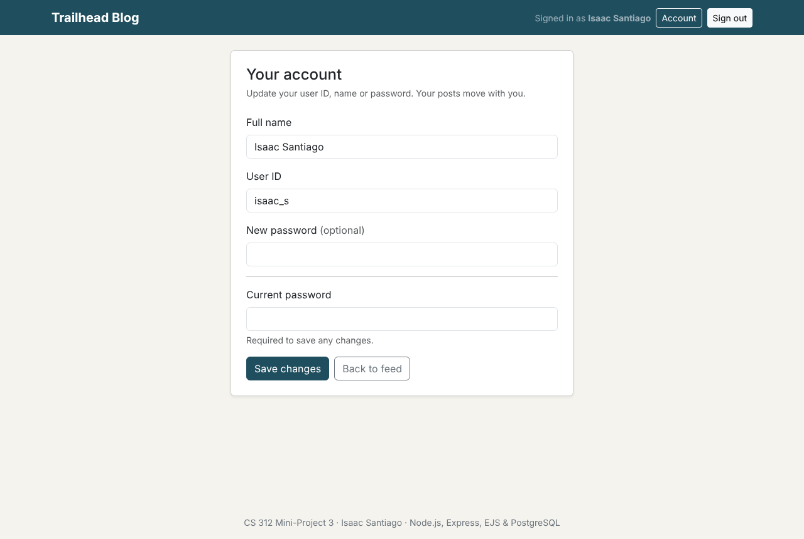
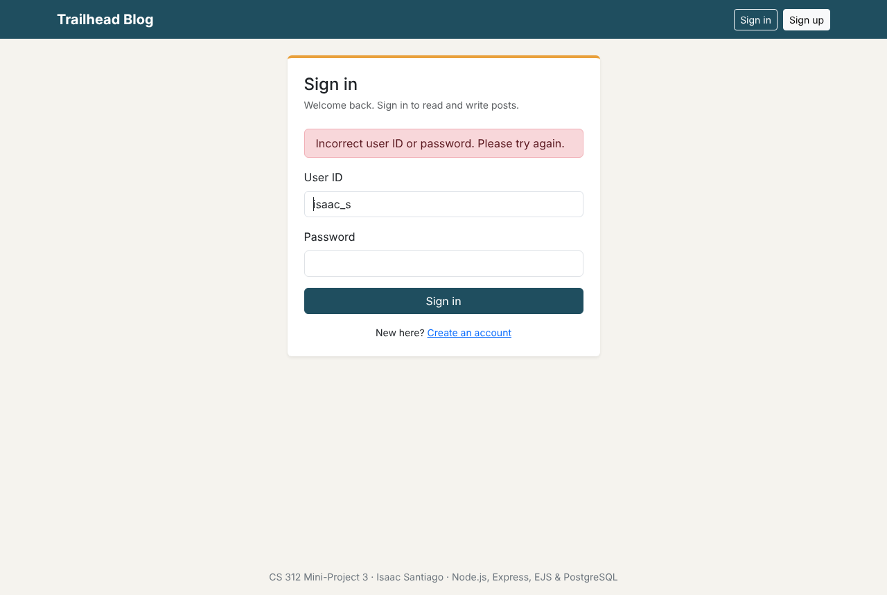
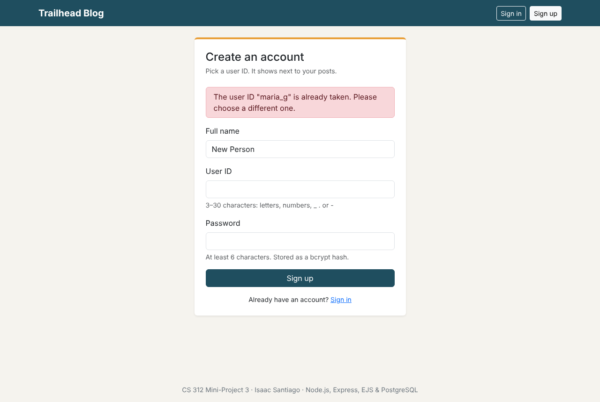

# CS-312 Mini-Project 3 (Updated): Blog with PostgreSQL and Authentication

Mini-Project 1's blog, rebuilt on **PostgreSQL**. Posts are stored in a `blogs` table and persist between sessions. Users sign up and sign in, and can only edit or delete posts they created.

**Stack:** Node.js, Express.js, EJS, PostgreSQL (`pg`), `express-session`, `bcryptjs`, Bootstrap 5

## Screenshots

| Feed (signed in) | Editing your own post |
|---|---|
|  |  |
| **Trying to edit someone else's post** | **Account page (bonus)** |
|  |  |
| **Wrong password** | **User ID already taken** |
|  |  |

## Database

**Database:** `BlogDB` · **Files:** [`db/schema.sql`](db/schema.sql), [`db/seed.sql`](db/seed.sql)

```
users                                   blogs
------------------------------          ------------------------------------------
user_id    VARCHAR(255) PK  <------+    blog_id         SERIAL PK
password   VARCHAR(255)  (bcrypt)  |    creator_name    VARCHAR(255)
name       VARCHAR(255)            +--- creator_user_id VARCHAR(255) FK -> users.user_id
created_at TIMESTAMP                    title           VARCHAR(255)   ON UPDATE CASCADE
                                        body            TEXT           ON DELETE CASCADE
                                        category        VARCHAR(50)
                                        date_created    TIMESTAMP
                                        date_updated    TIMESTAMP
```

The seed file inserts **3 users** and **5 blog posts**. You can sign in as any of these users:

| user_id | password | name |
|---|---|---|
| `isaac_s` | `Lumberjack26!` | Isaac Santiago |
| `maria_g` | `PineTrail#7` | Maria Gonzales |
| `jordan_k` | `DesertSun9!` | Jordan Kim |

### Which SQL runs for which action

| User action | SQL |
|---|---|
| Sign up: is the user ID taken? | `SELECT 1 FROM users WHERE user_id = $1` |
| Sign up: create the account | `INSERT INTO users (user_id, password, name) VALUES ($1, $2, $3)` |
| Sign in | `SELECT user_id, password, name FROM users WHERE user_id = $1`, then bcrypt compare |
| View the feed | `SELECT * FROM blogs ORDER BY date_created DESC` (with `WHERE category = $1` when filtered) |
| Create a post | `INSERT INTO blogs (...) VALUES (...)` |
| Edit a post | `UPDATE blogs SET title, body, category, date_updated WHERE blog_id = $4 AND creator_user_id = $5` |
| Delete a post | `DELETE FROM blogs WHERE blog_id = $1 AND creator_user_id = $2` |
| Update the account (bonus) | `UPDATE users ...` inside a transaction. `ON UPDATE CASCADE` moves posts to the new user ID. |

Every query is parameterized (`$1`, `$2`, ...) to prevent SQL injection.

## Authorization

- Signing in stores `{ user_id, name }` in the session. A `requireLogin` middleware protects the feed and every write route.
- Edit and Delete buttons only appear on your own posts. The server also checks ownership: `loadOwnPost()` compares `blogs.creator_user_id` with the session's `user_id` before any edit or delete. The SQL `WHERE` clause includes `creator_user_id` as a second safeguard. Someone who types another user's edit URL or sends a crafted POST gets "You can only edit or delete posts you created."

## Bonus: enhanced authentication

- **Hashed passwords.** Passwords are hashed with **bcrypt** (salted, 10 rounds) on sign-up and compared with `bcrypt.compare()` on sign-in. The suggested MD5 is fast to brute-force and unsalted, so bcrypt is the safer choice. User IDs stay plain text because they're shown publicly next to each post and used as the foreign key.
- **Account page** (`/account`). Change your user ID, name and/or password. Your current password is required. A new user ID is checked against existing ones. The update runs in a transaction, and `ON UPDATE CASCADE` re-points all your posts to the new user ID.

## Setup

1. **Create the database.** In pgAdmin, right-click *Databases* > *Create* > *Database...* and name it `BlogDB`.
2. **Create the tables and starter data.** Open the *Query Tool* on BlogDB, then run `db/schema.sql` followed by `db/seed.sql`.
   *Or* fill in `.env` (step 3) and run `npm run db:setup`, which runs both files for you.
3. **Configure.** Run `cp .env.example .env`, then set `PGPASSWORD` to your PostgreSQL password.
4. **Run.**
   ```bash
   npm install
   npm start        # http://localhost:3000
   ```

## Project structure

```
index.js        Express server: auth, blog CRUD, account routes
db.js           PostgreSQL connection pool
db/             schema.sql, seed.sql, setup.js
views/          EJS pages: index, edit, signin, signup, account, error, 404, plus partials/
public/css/     Styles
```
